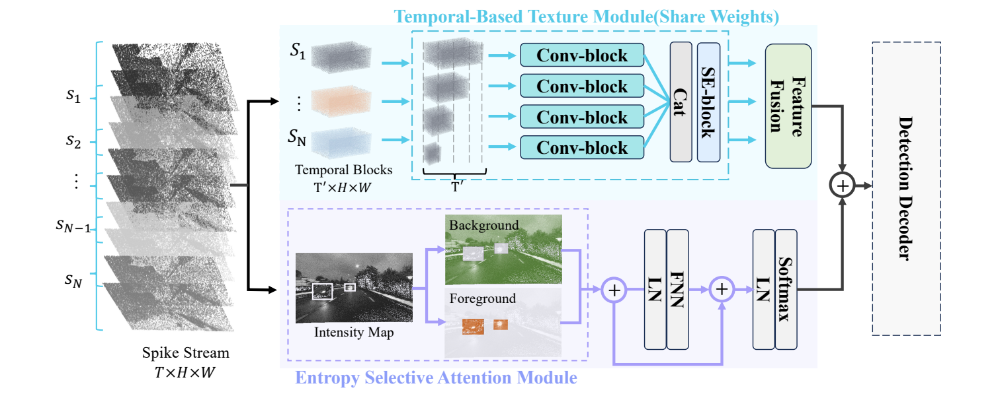
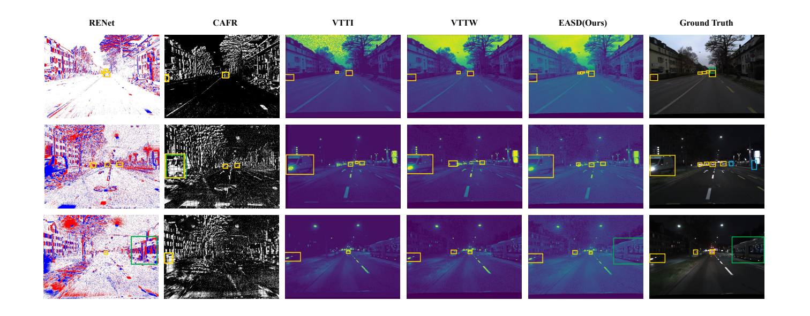
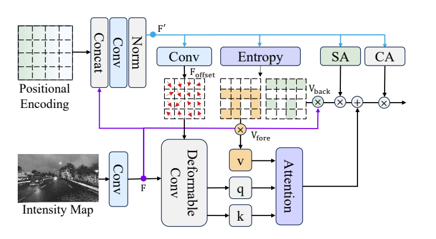
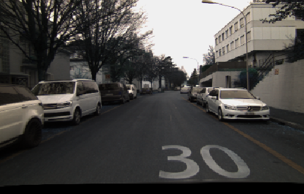
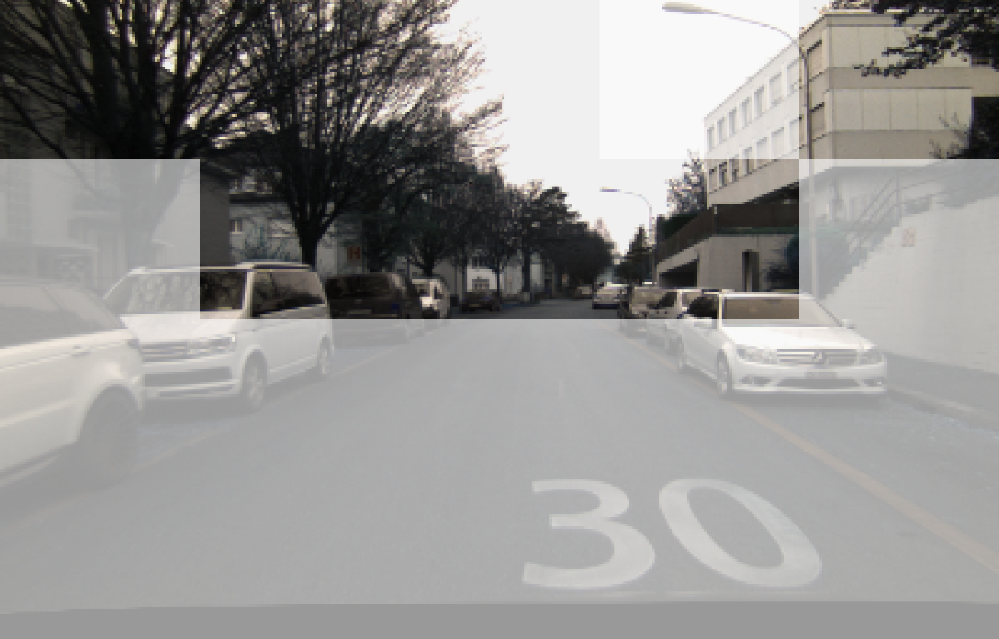
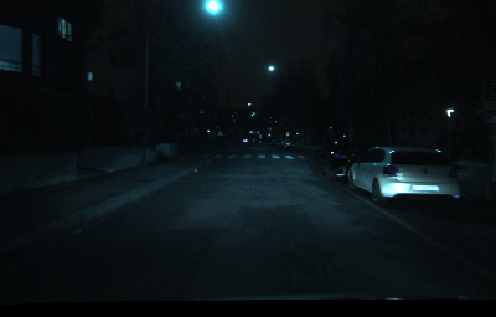
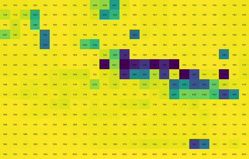
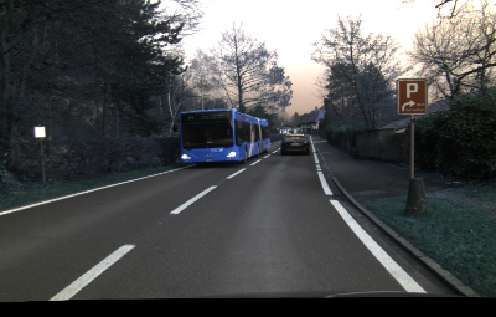
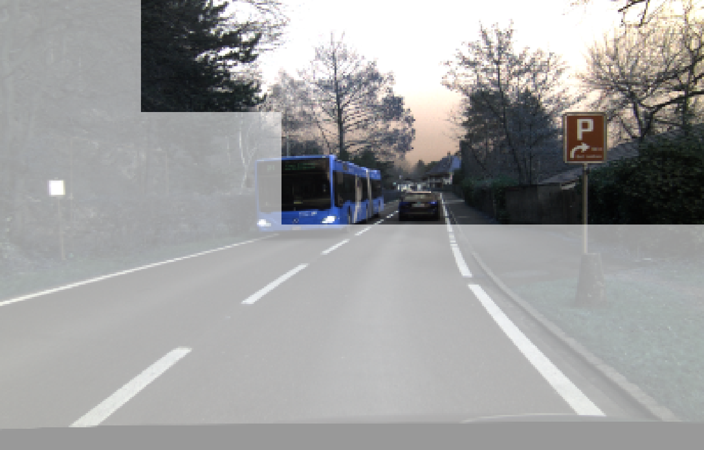

<div align="center">

# EASD

### Driving in Spikes: An Entropy-Guided Object Detector for Spike Cameras

**Ziyan Liu\*** · **Qi Su\*** · **Lulu Tang†** · **Zhaofei Yu†** · **Tiejun Huang**

Peking University · Beijing Academy of Artificial Intelligence

[](https://arxiv.org/abs/2511.15459)
[](https://www.python.org/)
[](https://pytorch.org/)
[](LICENSE)

[Paper](https://arxiv.org/abs/2511.15459) · [中文指南](docs/README_zh.md) · [Data](docs/DATA.md) · [Checkpoints](weights/README.md) · [Implementation notes](docs/IMPLEMENTATION.md)

\* Equal contribution. † Corresponding authors.

</div>

EASD detects objects directly from binary spike streams. A shared temporal texture branch captures cross-slice semantics, while an entropy selective attention branch focuses computation on informative spatial regions. The branches are fused and decoded with a pretrained CSPDarknet backbone and three YOLO detection heads.

<p align="center"></p>

## Highlights

- **Spike-native input:** `(B, 41, 250, 400)`, without reconstructing an RGB image first.
- **Complementary branches:** overlapping temporal texture extraction and entropy-guided spatial attention.
- **A small runtime:** PyTorch, torchvision, NumPy, Pillow, and tqdm; no custom CUDA extensions.
- **Ready to inspect:** CPU smoke training, checkpoint round trips, coordinate regression tests, and a GitHub Actions workflow.

## Quick start

```bash
git clone https://github.com/ricoflower/EASD.git
cd EASD
python -m venv .venv
source .venv/bin/activate
python -m pip install -r requirements.txt

# No dataset, pretrained weights, or network downloads are needed for these checks.
python train.py --smoke-test --device cpu
python -m unittest discover -s tests -v
python summary.py
```

The smoke test uses full-resolution synthetic binary spikes and runs a training update, validation, EMA checkpoint saving, strict checkpoint reloading, decoding, and NMS. Results are saved in a new `logs/` directory. This is an execution check; synthetic detections have no benchmark meaning.

The code has been exercised locally with Python 3.12, PyTorch 2.3.1, torchvision 0.18.1, and NumPy 2.0 on CPU. CUDA is supported by the entry points but has not been validated as part of this code cleanup. See [validation scope](docs/VALIDATION.md).

## Model interface

```python
import torch
from nets.yolo import YoloBody

model = YoloBody(
    anchors_mask=[[6, 7, 8], [3, 4, 5], [0, 1, 2]],
    num_classes=3,
    phi="s",
    pretrained=False,  # Set True after providing local CSPDarknet weights.
).eval()

with torch.no_grad():
    coarse, medium, fine, representation = model(
        torch.randint(0, 2, (1, 41, 250, 400)).float()
    )
```

| Tensor | Shape for the 3-class configuration |
| --- | --- |
| Input | `B × 41 × 250 × 400` |
| Coarse logits | `B × 24 × 16 × 25` |
| Medium logits | `B × 24 × 32 × 50` |
| Fine logits | `B × 24 × 64 × 100` |
| Fused representation | `B × 3 × 256 × 400` |

The model symmetrically pads three rows above and below the raw sensor canvas. Training labels use the padded coordinates internally; inference maps boxes back to the original `250 × 400` canvas. The effective detection strides are `16, 8, 4` after the decoder's 2× upsampling. One unbatched `(41,H,W)` tensor is also accepted and produces a batch of size one.

## Training

Prepare `.npy` spike tensors and normalized `xywh,class` annotation lists as described in [Data](docs/DATA.md). Place a matching pretrained backbone under `weights/`, or provide an explicit path:

```bash
python train.py \
  --input-type dsec \
  --train-annotations data/train.txt \
  --val-annotations data/val.txt \
  --backbone-weights weights/yolov5_s.pth \
  --epochs 6 --batch-size 8 --lr 1e-4 --device auto
```

Defaults follow the paper's training setup: Adam, cosine learning-rate decay, 6 epochs, batch size 8, and no augmentation. `--scratch` trains from random initialization. `--weights weights/easd_dsec_s.pth` loads a full EASD state dict and starts a fresh optimizer. Use `--amp` for CUDA mixed precision and `--max-steps 1` for a bounded execution check.

To exercise the regular dataset path with generated data:

```bash
python examples/make_toy_dataset.py --output data/toy
python train.py --scratch \
  --train-annotations data/toy/train.txt --val-annotations data/toy/val.txt \
  --epochs 1 --batch-size 1 --max-steps 1 --device cpu
```

Logs include `config.json`, `metrics.csv`, and best/last EMA model state dicts. Resuming optimizer state and multi-GPU training are outside this release's training interface.

## Inference and evaluation

Inference requires a trained EASD checkpoint. Checkpoints and full datasets are not bundled into this source repository; see [weight preparation](weights/README.md).

```bash
python predict.py \
  --input data/example.npy --input-type dsec \
  --weights weights/easd_dsec_s.pth \
  --device auto --output predictions
```

This writes a detection image and JSON in raw sensor coordinates. The Python API `YOLO.predict_tensor(spikes)` returns one `N × 6` array per sample: `[xmin, ymin, xmax, ymax, score, class_id]`.

```bash
python -m pip install -r requirements-eval.txt
python get_map.py \
  --annotations data/val.txt --weights weights/easd_dsec_s.pth \
  --metric voc --output map_out/validation
```

`--metric voc` reports VOC AP50; `--metric coco` reports COCO AP50:95 through pycocotools. These metrics are different. Training also supports `--eval-map` for an epoch-end VOC AP50 check.

## Results reported in the paper

The following values are **mAP@50**, transcribed from Tables 2–4 of arXiv v1. They have not been re-benchmarked with this cleaned implementation.

| Method | DSEC-Spike | PKU-Vidar-DVS |
| --- | ---: | ---: |
| Temporal branch only | 50.5 | 56.9 |
| Spatial branch only | 49.6 | 57.4 |
| **EASD** | **52.9** | **60.1** |

<p align="center"></p>

RGB frames in the paper are used for visualization and comparison; EASD's input is the spike stream.

## Entropy selective attention

Spatial windows are grouped using their entropy relative to the image's mean window entropy. Foreground windows receive offset-based window attention; background windows use lightweight spatial attention and convolution.

<p align="center"></p>

The examples below pair reference RGB frames with the author's original **window entropy distributions**. Each heatmap shows the entropy value of each spatial window. These are author-provided visualization assets, not outputs newly generated by this release. RGB frames provide scene context only.

| Reference frame | Window entropy distribution |
| --- | --- |
| **Daytime**<br> |  |
| **Nighttime**<br> |  |
| **Large vehicle**<br> |  |

See [asset provenance](docs/ASSETS.md) and [implementation differences](docs/IMPLEMENTATION.md).

## Repository layout

```text
nets/          temporal branch, spatial branch, CSPDarknet, YOLO loss and heads
utils/         spike I/O, datasets, checkpoints, train loop, decoding and evaluation
model_data/    class names and anchors; no model weights
examples/      deterministic synthetic data generator
tests/         data, routing, coordinates, gradients and state-dict regression tests
docs/          paper figures, guides, provenance and validation scope
weights/       checkpoint preparation instructions
.github/       CPU checks and issue templates
```

## Citation

```bibtex
@article{liu2025driving,
  title={Driving in Spikes: An Entropy-Guided Object Detector for Spike Cameras},
  author={Liu, Ziyan and Su, Qi and Tang, Lulu and Yu, Zhaofei and Huang, Tiejun},
  journal={arXiv preprint arXiv:2511.15459},
  year={2025}
}
```

## Acknowledgments and license

The detection framework is adapted from [bubbliiiing/yolov5-pytorch](https://github.com/bubbliiiing/yolov5-pytorch). The spatial mixer builds on [CAMixerSR](https://github.com/icandle/CAMixerSR). We thank the authors of these projects and the DSEC and PKU-Vidar-DVS datasets.

The GPL-3.0 license inherited from the original YOLO code is retained in [LICENSE](LICENSE). Upstream notices and the CAMixerSR Apache-2.0 license are preserved in [NOTICE](NOTICE) and [LICENSES](LICENSES/). See [CONTRIBUTING](CONTRIBUTING.md) for reporting and testing changes.
