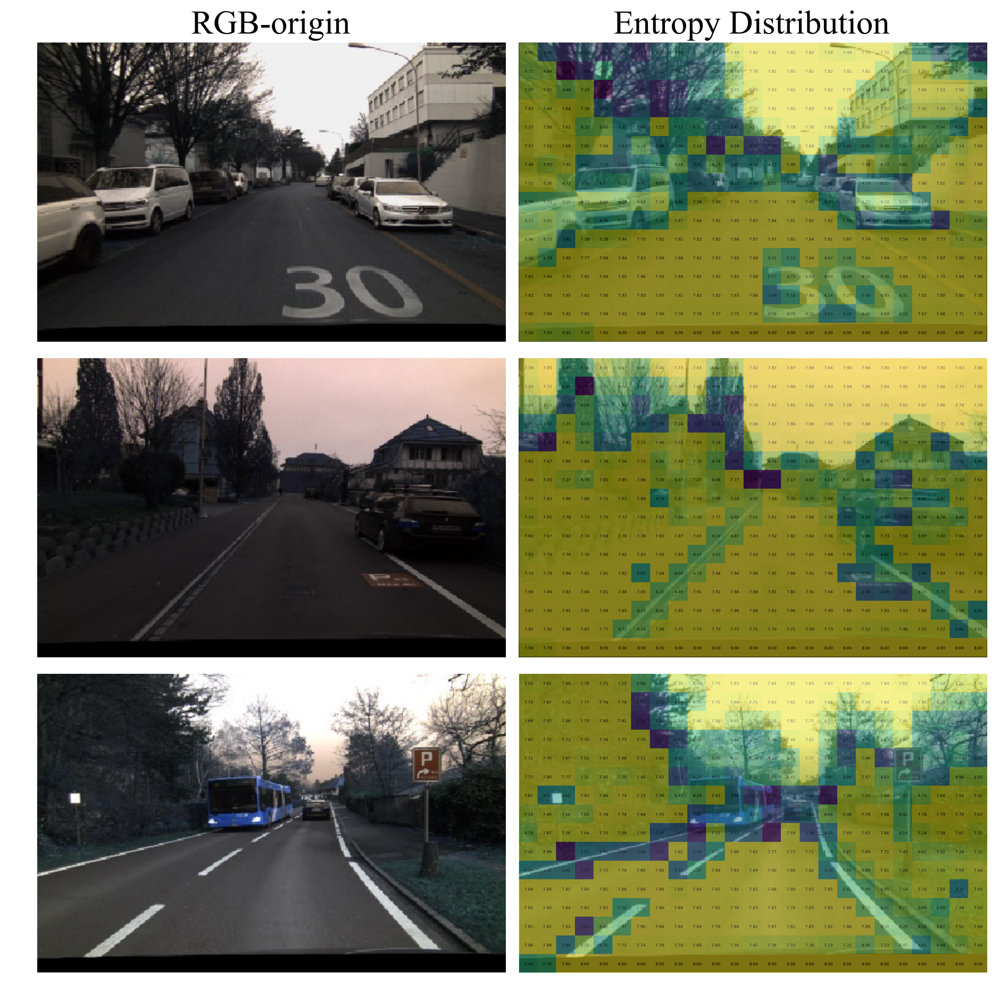
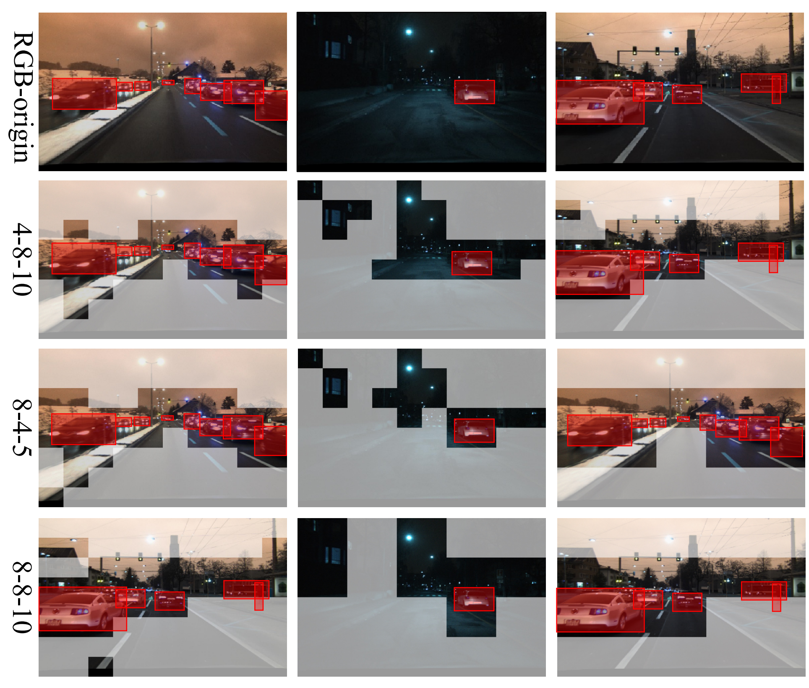

<div align="center">

# EASD

### Driving in Spikes: An Entropy-Guided Object Detector for Spike Cameras

**Ziyan Liu\*** · **Qi Su\*** · **Lulu Tang†** · **Zhaofei Yu†** · **Tiejun Huang**

Peking University · Beijing Academy of Artificial Intelligence

[](https://arxiv.org/abs/2511.15459)
[](https://www.python.org/)
[](https://pytorch.org/)
[](LICENSE)

[Paper](https://arxiv.org/abs/2511.15459) · [中文指南](docs/README_zh.md) · [Data](docs/DATA.md) · [Checkpoints](weights/README.md) · [Implementation notes](docs/IMPLEMENTATION.md)

\* Equal contribution. † Corresponding authors.

</div>

EASD detects objects directly from binary spike streams. A shared temporal texture branch captures cross-slice semantics, while an entropy selective attention branch focuses computation on informative spatial regions. The branches are fused and decoded with a pretrained CSPDarknet backbone and three YOLO detection heads.

<p align="center"></p>

## Highlights

- **Dual-branch object-centric representation:** EASD combines cross-slice global texture modeling through the Temporal-Based Texture and Feature Fusion Modules with an Entropy Selective Attention branch for object-centric spatial details.
- **DSEC-Spike benchmark:** A simulated spike-camera detection benchmark aligned with DSEC-Detection, supporting driving-scene object detection and evaluation across simulated and real spike data.
- **State-of-the-art results reported in the paper:** EASD achieves **52.9 mAP@50 on DSEC-Spike** and **60.1 mAP@50 on PKU-Vidar-DVS**, improving over the compared spike baselines by **11.2** and **2.2** percentage points, respectively. See the [reported results](#results-reported-in-the-paper).

## Quick start

```bash
git clone https://github.com/ricoflower/EASD.git
cd EASD
python -m venv .venv
source .venv/bin/activate
python -m pip install -r requirements.txt

# No dataset, pretrained weights, or network downloads are needed for these checks.
python train.py --smoke-test --device cpu
python -m unittest discover -s tests -v
python inspect_model.py
```

The smoke test uses full-resolution synthetic binary spikes and runs a training update, validation, EMA checkpoint saving, strict checkpoint reloading, decoding, and NMS. Results are saved in a new `logs/` directory. This is an execution check; synthetic detections have no benchmark meaning.

The code has been exercised locally with Python 3.12, PyTorch 2.3.1, torchvision 0.18.1, and NumPy 2.0 on CPU. CUDA is supported by the entry points but has not been validated as part of this code cleanup. See [validation scope](docs/VALIDATION.md).

## Network forward: raw outputs

`EASD` contains the temporal branch, entropy selective spatial branch, fusion, CSPDarknet decoder and detection heads. Its named output separates raw head logits from the fused representation. This example uses random initialization; trained detections use `EASDDetector` below.

```python
import torch
from easd import EASD

model = EASD(num_classes=3, variant="s").eval()
with torch.no_grad():
    output = model(torch.randint(0, 2, (1, 41, 250, 400)).float())
    coarse, medium, fine = output.head_logits
    representation = output.representation
```

| Tensor | Shape for the 3-class configuration |
| --- | --- |
| Input | `B × 41 × 250 × 400` |
| Coarse logits | `B × 24 × 16 × 25` |
| Medium logits | `B × 24 × 32 × 50` |
| Fine logits | `B × 24 × 64 × 100` |
| Fused representation | `B × 3 × 256 × 400` |

The model symmetrically pads three rows above and below the raw sensor canvas. Training labels use the padded coordinates internally; inference maps boxes back to the original `250 × 400` canvas. The effective detection strides are `16, 8, 4` after the decoder's 2× upsampling. One unbatched `(41,H,W)` tensor is also accepted and produces a batch of size one.

## Training

Prepare `.npy` spike tensors and normalized `xywh,class` annotation lists as described in [Data](docs/DATA.md). Place a matching pretrained backbone under `weights/`, or provide an explicit path:

```bash
python train.py \
  --input-type dsec \
  --train-annotations data/train.txt \
  --val-annotations data/val.txt \
  --backbone-weights weights/yolov5_s.pth \
  --epochs 6 --batch-size 8 --lr 1e-4 --device auto
```

Defaults follow the paper's training setup: Adam, cosine learning-rate decay, 6 epochs, batch size 8, and no augmentation. `--scratch` trains from random initialization. `--weights weights/easd_dsec_s.pth` loads a full EASD state dict and starts a fresh optimizer. Use `--amp` for CUDA mixed precision and `--max-steps 1` for a bounded execution check.

To exercise the regular dataset path with generated data:

```bash
python examples/make_toy_dataset.py --output data/toy
python train.py --scratch \
  --train-annotations data/toy/train.txt --val-annotations data/toy/val.txt \
  --epochs 1 --batch-size 1 --max-steps 1 --device cpu
```

Use `--variant s/m/l/x` to select the model size. Existing author checkpoints are migrated automatically and then loaded strictly; see [migration notes](docs/MIGRATION.md).

Logs include `config.json`, `metrics.csv`, and best/last EMA model state dicts. Resuming optimizer state and multi-GPU training are outside this release's training interface.

## Inference and evaluation

Inference requires a trained EASD checkpoint. Checkpoints and full datasets are not bundled into this source repository; see [weight preparation](weights/README.md).

```bash
python predict.py \
  --input data/example.npy --input-type dsec \
  --weights weights/easd_dsec_s.pth \
  --device auto --output predictions
```

This writes a detection image and JSON in raw sensor coordinates. For complete inference from Python:

```python
from easd import EASDDetector
from easd.spikes import load_spikes

# Loads a trained checkpoint containing both EASD branches, the decoder, and heads.
detector = EASDDetector(weights="weights/easd_dsec_s.pth", device="auto")
spikes = load_spikes("data/example.npy", input_type="dsec")
detections = detector.predict(spikes)[0]
# detections: N × 6 [xmin, ymin, xmax, ymax, score, class_id]
```

The complete path is `load_spikes → EASDDetector.predict → EASD → head decoding → confidence filtering → class-wise NMS → sensor-coordinate correction`. `EASD.forward` returns raw network outputs; `EASDDetector.predict` returns one final `N × 6` detection array per sample.

```bash
python -m pip install -r requirements-eval.txt
python evaluate.py \
  --annotations data/val.txt --weights weights/easd_dsec_s.pth \
  --metric voc --output map_out/validation
```

`--metric voc` reports VOC AP50; `--metric coco` reports COCO AP50:95 through pycocotools. These metrics are different. Training also supports `--eval-map` for an epoch-end VOC AP50 check.

## Results reported in the paper

The following values are **mAP@50**, transcribed from Tables 2–4 of arXiv v1. They have not been re-benchmarked with this cleaned implementation.

| Method | DSEC-Spike | PKU-Vidar-DVS |
| --- | ---: | ---: |
| Temporal branch only | 50.5 | 56.9 |
| Spatial branch only | 49.6 | 57.4 |
| **EASD** | **52.9** | **60.1** |

<p align="center"></p>

RGB frames in the paper are used for visualization and comparison; EASD's input is the spike stream.

## Entropy selective attention

Spatial windows are grouped using their entropy relative to the image's mean window entropy. Foreground windows receive offset-based window attention; background windows use lightweight spatial attention and convolution.

<p align="center"></p>

### Feature entropy distribution

The manuscript's original Figure 7 shows reference RGB frames alongside **RGB–entropy overlays**. Entropy is computed per feature window: brighter colors indicate higher entropy and darker colors indicate lower entropy. The RGB image supplies visual context. Open the figure at full resolution to inspect the window values.

<p align="center"></p>

### Foreground mask selection

The manuscript's original Figure 8 compares foreground selection across window and merge settings. **Unmasked regions are selected foreground; masked regions are background; red boxes mark ground-truth objects.** The original panel layout and setting labels (`4-8-10`, `8-4-5`, `8-8-10`) are retained. The RGB frames provide a visual reference for masks computed from spike features.

<p align="center"></p>

These two figures are extracted directly from page 8 of the author-provided EASD manuscript. See [figure provenance](docs/ASSETS.md) for source-version details and [implementation notes](docs/IMPLEMENTATION.md) for the executable model's settings.

## Repository layout

```text
easd/          EASD model, branches, decoder, data, loss and inference
configs/       class mappings and anchors
train.py       training and end-to-end smoke test
predict.py     spike recording → detection JSON and image
evaluate.py    VOC AP50 / official COCO AP50:95
inspect_model.py  output shapes and parameter count
examples/      deterministic synthetic data generator
tests/         data, routing, gradients, checkpoints, postprocessing and metrics
docs/          paper figures, guides, provenance and validation scope
weights/       checkpoint preparation instructions
.github/       automated checks and issue templates
```

## Citation

```bibtex
@article{liu2025driving,
  title={Driving in Spikes: An Entropy-Guided Object Detector for Spike Cameras},
  author={Liu, Ziyan and Su, Qi and Tang, Lulu and Yu, Zhaofei and Huang, Tiejun},
  journal={arXiv preprint arXiv:2511.15459},
  year={2025}
}
```

## Acknowledgments and license

The detection framework is adapted from [bubbliiiing/yolov5-pytorch](https://github.com/bubbliiiing/yolov5-pytorch). The spatial mixer builds on [CAMixerSR](https://github.com/icandle/CAMixerSR). We thank the authors of these projects and the DSEC and PKU-Vidar-DVS datasets.

The GPL-3.0 license inherited from the original YOLO code is retained in [LICENSE](LICENSE). Upstream notices and the CAMixerSR Apache-2.0 license are preserved in [NOTICE](NOTICE) and [LICENSES](LICENSES/). See [CONTRIBUTING](CONTRIBUTING.md) for reporting and testing changes.
