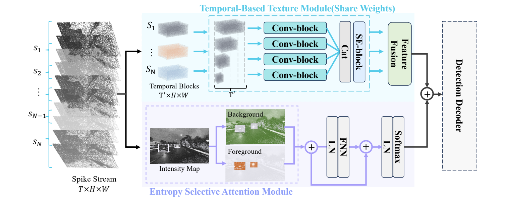

# EASD 中文使用指南

EASD 对二值脉冲流直接进行目标检测，模型由共享时序纹理模块、基于熵的空间注意力模块和预训练 CSPDarknet 解码器组成。论文见 [Driving in Spikes](https://arxiv.org/abs/2511.15459)。



## 快速运行

```bash
git clone https://github.com/ricoflower/EASD.git
cd EASD
python -m venv .venv
source .venv/bin/activate
python -m pip install -r requirements.txt
python train.py --smoke-test --device cpu
python -m unittest discover -s tests -v
```

冒烟测试自动随机初始化，无需下载数据或权重。它执行完整 `41×250×400` 输入的训练更新、验证、EMA 保存、严格重载、解码和 NMS。结果写入 `logs/` 下的新目录。

## 输入与坐标

输入 shape 为 `(B,41,250,400)`，也接受单个 `(41,250,400)`。时间维是连续的 41 帧二值脉冲。模型内部上下各做 3 行 symmetric padding，得到 `256×400`。数据加载器同步转换标签；推理结束后再去掉 padding 的坐标偏移。

DSEC 三类映射为 `0=person, 1=large_vehicle, 2=car`。返回的三个检测张量分别为 `(B,24,16,25)`、`(B,24,32,50)` 和 `(B,24,64,100)`，第四个张量为三通道融合表征。

标注每行使用原始画面上的归一化 `xywh,class_id`：

```text
spikes/sample.npy 0.5,0.6,0.2,0.3,2
```

相对路径默认相对于标注文件。详见 [数据格式](DATA.md)。PKU `.dat` 使用 `--input-type spike`，按固定 `250×400` 解析并提取 `[180:221]`，对应的 classes 文件是九类 `model_data/spike.txt`。

## 训练与推理

```bash
python train.py \
  --train-annotations data/train.txt --val-annotations data/val.txt \
  --backbone-weights weights/yolov5_s.pth \
  --epochs 6 --batch-size 8 --lr 1e-4 --device auto

python predict.py --input data/example.npy \
  --weights weights/easd_dsec_s.pth --output predictions
```

默认训练配置为 Adam、余弦退火、6 epochs、batch size 8，无数据增强。`--scratch` 表示随机初始化；`--weights` 严格加载完整模型并重新创建优化器；`--backbone-weights` 只加载主干。权重和完整数据集没有打包到源码仓库，目前没有填入公开下载链接，准备方式见 [权重说明](../weights/README.md)。

```bash
python -m pip install -r requirements-eval.txt
python get_map.py --annotations data/val.txt \
  --weights weights/easd_dsec_s.pth --metric voc --output map_out/val
```

`voc` 是 VOC AP50，`coco` 是 COCO AP50:95，不能混用。论文表格里的 `52.9/60.1` 为 mAP@50。本次开源整理验证了运行链路，没有重新完成论文的全量训练与指标复现。

## 网络前向与完整推理

`nets/yolo.py` 的 `YoloBody` 沿用 YOLO 框架的类名，内部实际包含完整 EASD：时序纹理提取与融合、熵选择空间注意力、双分支融合、CSPDarknet 和三个检测头。直接调用它返回三个尺度的原始 logits 和融合表征。

完整推理入口是 `yolo.py` 的 `YOLO.predict_tensor()`：加载训练好的完整模型权重后，执行网络前向、框解码、置信度过滤、逐类别 NMS、去除 padding 偏移和原图坐标裁剪，得到 `[xmin,ymin,xmax,ymax,score,class_id]`。`predict.py` 在此基础上负责读取数据和保存 JSON/检测图。

```python
from utils.spikes import load_spikes
from yolo import YOLO

detector = YOLO(model_path="weights/easd_dsec_s.pth", device="auto")
spikes = load_spikes("data/example.npy", input_type="dsec")
detections = detector.predict_tensor(spikes)[0]
```

## 实现与开源内容

时序、空间、主干分别位于 `nets/temporal.py`、`nets/spatial.py`、`nets/CSPdarknet.py`。仓库包含训练/推理/评估入口、自动测试、GitHub Actions、英文首页、论文配图、原始熵掩码示例、引用文件和上游许可声明。历史日志、服务器绝对路径、无关实验模块和大权重没有放入源码树。

当前实现优先保留旧 checkpoint 的实际计算方式。论文中的 deformable convolution、注意力缩放等描述与原始代码存在差异，已明确记录在 [实现说明](IMPLEMENTATION.md)，没有在整理时擅自替换算子。验证范围见 [VALIDATION](VALIDATION.md)。

代码保留原 YOLO 仓库的 GPL-3.0 许可；CAMixerSR 来源与 Apache-2.0 许可保存在 `NOTICE` 和 `LICENSES/`。
